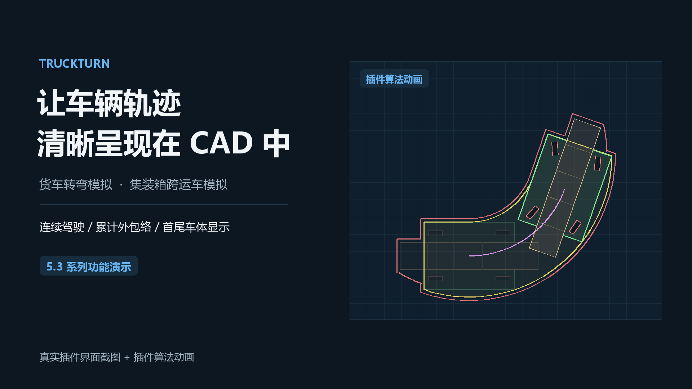

# TruckTurn 5.4.0

在CAD中模拟货车整车、铰接半挂、集装箱搬运车和两轴消防车的行驶轨迹、轮迹及扫掠包络。支持交互驾驶、倒车、仅保留首尾车体或保留全部节点，以及录制后的动画回放。

本次统一交付AutoCAD、浩辰CAD、中望CAD，共12组Windows64位DLL。**只能加载与软件及年份对应的DLL。编译和离线回归通过，不代表所有CAD年份均已完成实机验收。**

[下载三平台交付包](https://github.com/179221886-png/TruckTurn-CAD/releases/tag/v5.4.0) · [安装及操作指南](docs/TruckTurn_5.4_安装与使用指南.md) · [本次更新](RELEASE_NOTES.md)

## 功能演示

点击封面查看演示视频（约1分27秒），或[下载MP4](https://raw.githubusercontent.com/179221886-png/TruckTurn-CAD/main/docs/media/truckturn-demo-v5.3.mp4)。

展示货车及铰接半挂转弯、集装箱搬运车四种转向方式、累计外包络与首尾车体显示。视频由真实插件界面截图与算法动画组成，非CAD操作实录；对应5.3系列，5.4新增的消防车、轨迹播放和中望CAD适配请见[更新说明](RELEASE_NOTES.md)。

## 版本选择

|CAD软件|年份|目标运行时|DLL位置|
|---|---|---|---|
|AutoCAD|2018|.NET Framework 4.6|dist/AutoCAD/2018/TruckTurn.AutoCAD2018.dll|
|AutoCAD|2019–2020|.NET Framework 4.7|dist/AutoCAD/2019-2020/TruckTurn.AutoCAD2019_2020.dll|
|AutoCAD|2021–2024|.NET Framework 4.8|dist/AutoCAD/2021-2024/TruckTurn.AutoCAD2021_2024.dll|
|AutoCAD|2025–2026|.NET 8目标|dist/AutoCAD/2025-2026/TruckTurn.AutoCAD2025_2026.dll|
|AutoCAD|2027|.NET 10|dist/AutoCAD/2027/TruckTurn.AutoCAD2027.dll|
|浩辰CAD|2025|.NET Framework 4.8|dist/GstarCAD/2025/TruckTurn.GstarCAD2025.dll|
|浩辰CAD|2026|.NET 8|dist/GstarCAD/2026/TruckTurn.dll|
|中望CAD|2022|.NET Framework 4.7|dist/ZWCAD/2022/TruckTurn.ZWCAD2022.dll|
|中望CAD|2023|.NET Framework 4.7|dist/ZWCAD/2023/TruckTurn.ZWCAD2023.dll|
|中望CAD|2024|.NET Framework 4.7|dist/ZWCAD/2024/TruckTurn.ZWCAD2024.dll|
|中望CAD|2025|.NET Framework 4.7|dist/ZWCAD/2025/TruckTurn.ZWCAD2025.dll|
|中望CAD|2026|.NET Framework 4.7|dist/ZWCAD/2026/TruckTurn.ZWCAD2026.dll|

中望需要支持.NET的专业版或相应行业版，标准版不支持；2027 Beta、未来版本、32位、Linux和鸿蒙不在本次交付范围。[官方版本比较](https://www.zwsoft.com/user-guide/differences-between-zwcad-standard-professional-and-mfg)、[官方开发支持](https://www.zwsoft.cn/support/zwcad-devdoc)。

AutoCAD分组参考[官方Managed .NET兼容性表](https://help.autodesk.com/cloudhelp/2027/CHS/AutoCAD-Customization/files/GUID-A6C680F2-DE2E-418A-A182-E4884073338A.htm)。2025 Update 1.4+、2026 Update 1.2+的宿主升级到.NET10后，.NET8应用通常仍能运行，但这些补丁须现场测试。[2025说明](https://help.autodesk.com/cloudhelp/2025/ENU/AutoCAD-WhatsNew/files/GUID-07450FCA-16CA-4D7A-8EA2-9CE842631D75.htm)、[2026说明](https://help.autodesk.com/cloudhelp/2026/ENU/AutoCAD-WhatsNew/files/GUID-FAB1960D-49C1-4A12-B128-5511F7889AB9.htm)。

## 快速使用

1. 关闭并重启CAD，进入对应软件和年份目录。AutoCAD2018的System.ValueTuple.dll及许可证须一并保留；随包的.deps.json保持与DLL同目录。
2. 用NETLOAD加载该目录的TruckTurn DLL。若被安全加载拦截，只将固定插件目录加入可信位置，不要关闭全局安全保护。
3. 选择命令、设置与图面实际数值一致的图纸单位及车型参数，按提示放置车辆并确认节点；连续驾驶用X结束出图。
4. 出图后选择P打开动画，或用TTPLAY选择新生成的完整结果块。

|功能|命令|
|---|---|
|货车整车或铰接半挂连续驾驶|TRUCKDRIVE|
|一键90°转弯|TRUCKTURN90|
|集装箱搬运车|CARRIERDRIVE，或CAR|
|两轴消防车|FIREDRIVE，或FIRE|
|轨迹动画回放|TTPLAY|
|关闭动画并清理临时车辆|TTSTOP|

首尾车体选项只影响车体数量，不删除中间包络、轮迹或录制数据。旧版纯静态轨迹没有回放快照，不能直接还原动画。现有图块不会因重新选型而自动更新，修正尺寸后应重新绘制。

## 5.4.0主要更新

- 新增消防车专属选型，区分厂家公开尺寸与插件估算参数。
- 新增路线播放、暂停、进度定位、倍速和循环；使用临时图形，不逐帧向DWG写入车辆实体。
- 新增中望2022—2026五组适配；12组DLL版本元数据统一为5.4.0.0。
- 修复半挂车反复确认尺寸缩水、搭接总长与预览不一致，补齐精度保留、轮胎外伸/净距校验、多轴外观与轮迹一致性。
- 更新车辆侧视预览，保留首尾/全部节点模式及已有实时包络、平滑与长路径缓存优化。

## 数据口径与工程边界

集装箱外形尺寸参考国际标准ISO668，GP为General Purpose普通用途箱、HC为High Cube高箱；2×20为组合工况，不是独立ISO箱型。ISO不能当作搬运车或消防车的厂家参数认证。[ISO668](https://www.iso.org/standard/76912.html)。

通用货车轴距/前后悬、轴组1.35m示意间距、搬运车通用模板及部分消防参数属于可编辑假设。多轴外观仍使用等效两轴运动学；消防目前仅支持两轴普通前桥转向。二维轨迹不代替载重稳定性、实际驾驶、净高校核或消防通行审查。

本包通过对应API编译、源码链接回归、命令/依赖/架构及哈希检查，但未完成12组真实CAD逐一验收。先在测试图中核对尺寸、米/毫米单位、转弯/倒车、X出图和动画清理。见[验证及已知限制](docs/验证与已知限制.md)、[AutoCAD验收](docs/AutoCAD_实机验收清单.md)、[中望验收](docs/ZWCAD_实机验收清单.md)。

## 源码与构建

- src/AutoCAD：五组项目，使用Autodesk官方AutoCAD.NET版本化API引用。
- src/GstarCAD：浩辰2025/2026项目及离线验证器。须自行提供合法GcMgd/GcDbMgd/GcCoreMgd引用，放在lib2025与lib，不随插件分发。
- src/ZWCAD：五个年版项目、构建脚本及移植说明，须提供同年ZwManaged/ZwDatabaseMgd；目标.NET Framework4.7，非.NET8。[构建说明](src/ZWCAD/README.md)。
- dist：可加载DLL和必要依赖，不含厂商SDK。BUILD_MANIFEST.json及SHA256SUMS.txt用于追溯和校验。

仓库中原5.3 Word仅保留为历史参考；本次交付包以[5.4指南](docs/TruckTurn_5.4_安装与使用指南.md)为准，不要按旧Word中的DLL名称选择本次文件。

## 权利说明

TruckTurn暂不添加开源许可证。公开查看源码不等于获得复制、修改或再发布授权，沿用仓库原有权利安排。System.ValueTuple按随包MIT许可和第三方通知单独分发，不代表TruckTurn或CAD API采用MIT许可。Autodesk、浩辰、中望及其API属于各自权利人。插件不绕过CAD许可或关闭安全保护。
